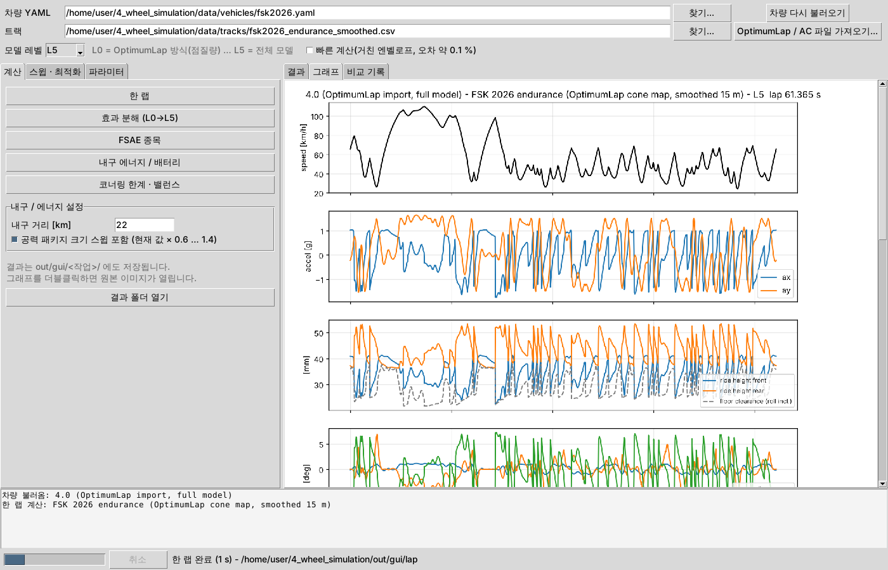
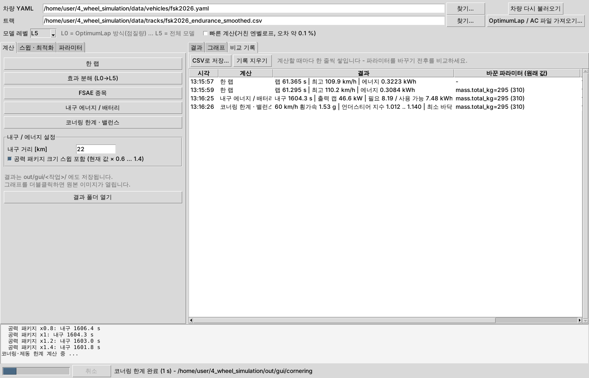

# aerolap — FSAE 공력·서스펜션 연성 랩타임 시뮬레이터

OptimumLap은 차량을 **점질량**으로 보고 공력을 `Cl·A`, `Cd·A` 두 상수로만 다룹니다. 그래서 다음을 계산하지 못합니다.

| OptimumLap이 반영하지 못하는 것 | aerolap에서 |
|---|---|
| 다운포스의 전/후 배분(CoP)이 언더/오버스티어 한계에 주는 영향 | 축별 그립 한계, 언더스티어 지수 |
| 하중이동과 타이어 하중 민감도 (어느 바퀴에 다운포스가 실리는가) | 코너별 4개 타이어 하중, `μ(Fz)` |
| 항력 작용 높이에 의한 후방 하중이동 | `drag_height_mm` |
| 다운포스·제동·가속으로 차체가 내려가고 기울면서 공력이 바뀌는 연성 | 히브·피치 → 차고 → aero map → 다시 하중 (고정점 평형) |
| 코너링 롤과 차체 슬립각(yaw)에 따른 공력 손실, 캠버 변화 | 롤·요 → aero map, 캠버 → 그립 |
| DRS / 액티브 에어로 (작동 지연 포함) | `fixed / rule / ideal` 전략 |
| 바닥 접촉(bottoming) | 최소 바닥 간극 계산·제약 |
| 모터 특성: 전압에 따른 기저 속도, 효율, 로터 관성, 연속 정격 | EMRAX 228 데이터시트 모델, 배터리 출력 한계 |
| 배터리 용량: 항력이 큰 윙이 내구 에너지를 얼마나 더 쓰고, 용량이 모자라면 얼마나 느려지는가 | 랩 에너지 분해(항력·제동·손실·회생), 에너지 한계 내구(출력 캡) |
| 과도 응답: 차체·바퀴 진동, 노면, 언더/오버스티어, 라인 이탈 | 과도 솔버(7자유도 라이드 + 횡·요 + 조향 드라이버) |
| 실제 타이어 데이터(TTC): 하중별 코너링 강성·피크 슬립각, 캠버 추력, 공기압, 복합 슬립 | **Pacejka Magic Formula `.tir`** (MF 5.2/6.1) |
| 트랙 폭 안의 주행 라인 (입력한 선 대신) | **레이싱 라인 최적화** (최소 곡률 + 경로 길이, 랩타임으로 선택) |
| 같은 배터리로 더 빠른 내구 주행: 제동 전 코스팅, 가속 조절 | **에너지 최적 주행** (동적 계획법, 리프트 지점) |
| 셀·모터 온도와 온도 한계, 온도에 따른 셀 내부저항 | **셀·모터 집중 열용량 모델**, 온도 한계 출력 캡 |
| 고저차(오르막·내리막) | 트랙 고도 → 경사 `g sin θ` |

같은 차량을 **OptimumLap 방식(L0)부터 전체 모델(L5)까지 효과를 하나씩 켜며** 돌려 각 효과가 랩타임을 얼마나
바꾸는지 분해하고, 스프링·ARB·3rd 스프링·정적 차고(레이크)·공력 배분 같은 **셋업을 코너링/랩타임 기준으로
최적화**할 수 있습니다. 기본 해석은 준정적(QSS)이고, 같은 물리 모델 위에서 **과도(transient, 시간영역) 솔버**로 차체·바퀴의
스프링·댐퍼 동역학, 노면 요철, 횡·요 운동과 조향 드라이버, DRS 플랩 작동 속도까지 넣어 다시 돌려 볼 수 있습니다
([docs/architecture.md](docs/architecture.md)). 예제 EV는 **EMRAX 228** 모터 데이터시트 값으로 구동계를 계산합니다.

> `data/`의 차량·aero map·트랙은 경향만 그럴듯하게 만든 **가상 예제**입니다. 실제 판단에는 팀의 CFD/풍동,
> 타이어(TTC 등), 서스펜션 데이터를 넣으세요.

## 설치

Python 3.10 이상.

```bash
pip install -e ".[dev]"
```

## GUI (명령어 없이 쓰기)

```bat
py -m aerolap.gui
```

또는 저장소 폴더의 **`aerolap_gui.bat`을 더블클릭**합니다(추가 설치 없음, Python 기본 tkinter 사용).



1. 위에서 **차량 YAML**과 **트랙**을 고릅니다(기본: 26년도 차, FSK 내구 트랙 평활화). OptimumLap `.olveh`/`.oltra`나 Assetto Corsa
   `.ai`는 **"OptimumLap / AC 파일 가져오기..."**로 바로 변환해 불러옵니다. 차량 선택 창에서 `.olveh`를 골라 변환 없이 쓸 수도 있습니다.
   가져올 때 옵션 창이 뜹니다:
   - 차량(`.olveh`) 구동계: **OptimumLap 동등**(파일의 토크 곡선, 기본 — L0을 OptimumLap과 비교할 때) /
     **전체 모델**(EMRAX 228 모터 + 배터리, 파일 이름 끝 `_full`)
   - 트랙(`.oltra`) **선 평활화**: 기본 끔(OptimumLap 구간 길이·반경 그대로). 켜면 x-y 선으로 다시 그려 콘맵 곡률 잡음을
     없애지만 길이·반경이 바뀌어 랩이 빨라집니다(파일 이름 끝 `_smooth15`). 이미 평활화한 트랙에는 켜지 마세요
2. **파라미터** 탭: 질량, 무게중심, 스프링·ARB, 차고, 공력 장치(윙 받음각·스팬·플랩 각, 바닥 크기, 사이드포드 출구), 배터리
   셀·팩 값을 고칩니다. 장치 위치·지상고·코드·갭·오버랩·엔드플레이트·냉각 같은 세부 값은 **"공력 장치 상세"**를 켜야
   보입니다(숨겨도 값은 그대로 쓰이고, 스윕 목록에는 모두 나옵니다). 바꾼 값은 파란색으로
   표시되고, "YAML로 저장"은 원래 파일 맨 위 주석(ASSUMED 목록)을 남깁니다
3. **계산** 탭: 한 랩 / 효과 분해(L0→L5) / FSAE 종목 / 내구 에너지·배터리 / 코너링 한계·밸런스
4. **스윕 · 최적화** 탭: 값 하나를 범위로 바꿔 보는 **파라미터 스윕**(목적: 한 랩 / 내구 / 스키드패드), **공력 장치 최적화**
   (끝나면 "최적값을 파라미터에 적용"). **"공력 전체 계산"** 버튼은 버튼 하나로 ① 현재 차 공력 작동 영역 ② 공력 교환비
   ③ 모든 장치(앞 윙·사이드 윙·사이드포드·리어 윙, 플랩 각도 포함) 동시 최적화 ④ 최적화된 차의 작동 영역 점검을 차례로
   돌립니다. 목적·언더스티어 범위·평가 횟수는 최적화 설정을 따르고, 결과는 `out/gui/aero_all/`에 단계별 폴더,
   요약 보고서 `aero_all.txt`, `optimized_vehicle.yaml`로 저장됩니다
5. 결과는 오른쪽 **결과·그래프** 탭에 나오고(그래프 더블클릭 = 원본 이미지), 실행할 때마다 **비교 기록** 탭에 한 줄씩
   쌓입니다(바꾼 파라미터와 결과, CSV 저장). 계산 중에는 진행 막대와 **취소** 버튼이 있습니다



"빠른 계산"을 켜면 거친 엔벨로프로 몇 배 빨라집니다(랩타임 오차 약 0.1 %).
차량 파일에 모르는 키(오타)가 있으면 로그 창(명령줄은 stderr)에 비슷한 이름과 함께 경고가 나옵니다.

**26년도 차·FSK 트랙 결과 모음: [docs/results_fsk2026.md](docs/results_fsk2026.md)**

## 빠른 시작

```bash
# 한 랩 (폐회로 트랙은 flying lap, 개회로는 standing start가 기본)
aerolap run data/vehicles/fsae_ev_aero.yaml data/tracks/fsae_endurance_example.csv
```

```bash
# OptimumLap 동등(L0) -> 전체 모델(L5) 효과 분해
aerolap compare data/vehicles/fsae_ev_aero.yaml data/tracks/fsae_autocross_example.csv
```

```bash
# 속도별 정상상태 코너링 한계와 그때의 차고·롤·요·ClA·CoP, 직선 제동 한계
aerolap cornering data/vehicles/fsae_ev_aero.yaml
```

```bash
# FSAE 다이내믹 종목
aerolap events data/vehicles/fsae_ev_aero.yaml --autocross data/tracks/fsae_autocross_example.csv --endurance data/tracks/fsae_endurance_example.csv
```

```bash
# 내구 에너지 예산: 배터리 용량 안에 들어가는가, 항력 몫, 모자라면 출력 캡과 랩타임
aerolap energy data/vehicles/fsae_ev_aero.yaml data/tracks/fsae_endurance_example.csv
```

```bash
# 셋업 최적화 (예제: 오토크로스 랩타임, 7개 변수, 바닥 간극·롤·언더스티어·승차 주파수 제약)
aerolap optimize data/optimize/cornering_setup.yaml
```

결과는 `out/<명령>/`에 텍스트 요약, CSV 트레이스, PNG 그래프로 저장됩니다(`--out`으로 변경).

## 명령

| 명령 | 하는 일 | 주요 출력 |
|---|---|---|
| `run VEHICLE TRACK` | 한 랩 시뮬레이션 (`--mat`: MATLAB용 `trace.mat`) | `summary.txt`, `trace.csv`, `lap.png`, `track_map.png` |
| `compare VEHICLE TRACK` | 효과 단계 L0–L5 랩타임 분해 (`--levels L0,L3,L5`) | `ladder.txt`, `ladder.png`, `compare.png` |
| `transient VEHICLE TRACK` | 시간영역 랩: 7자유도 라이드·공력 동역학, 노면 요철, QSS와 비교 (`--road A..E/CSV`, `--road-seed`, `--dt`, `--iterations`, `--max-jerk`, `--turn-in`) | `transient.txt`, `dynamics.png`, `trace_transient.csv` |
| `cornering VEHICLE` | 속도별 코너링·제동 한계와 자세 (`--speeds 30:120:10`, `--mode drs`) | `cornering.txt`, `cornering.png` |
| `ggv VEHICLE` | g-g-V 엔벨로프 (`--all-modes`, `--export`: `ggv.csv`·MATLAB `ggv.mat`) | `ggv.png` |
| `sweep VEHICLE --param PATH=a:b:step` | 1D/2D 파라미터 스윕 (`--param` 두 번이면 등고선) | `sweep.txt`, `sweep.png` |
| `sensitivity VEHICLE --params p1,p2` | 목적함수의 파라미터별 민감도(중앙차분) | `sensitivity.txt` |
| `optimize SPEC.yaml` | 제약 조건부 셋업 최적화 | `optimization.txt`, `optimization.png`, `optimized_vehicle.yaml` |
| `events VEHICLE` | 가속 75 m, 스키드패드, 오토크로스, 내구(배터리 에너지 한계·모터 열 점검 포함) | `events.txt` |
| `energy VEHICLE TRACK` | 내구 에너지 예산·분해, 용량 부족 시 출력 캡 (`--distance-km 22`, `--param aero.cla_scale,aero.cda_scale=0.6:1.4:0.2`, `--relative`: 현재 값 × 배율) | `energy.txt`, `energy_sweep.png` |
| `energy-strategy VEHICLE TRACK` | **에너지 최적 내구 주행**(동적 계획법): 같은 배터리 에너지로 리프트 앤 코스트·가속 조절 vs 출력 캡, 코스팅 지점 (`--target-kwh`, `--dv`) | `energy_strategy.txt`, `.png`, `lift_points.csv`, `trace_optimal.csv` |
| `import-track FILE` | Assetto Corsa AI 라인(`fast_lane.ai`)·OptimumLap 트랙(`.oltra`)을 트랙 CSV로 (`--cutoff 10`, `--smooth 15`, `--reverse`) | 트랙 CSV |
| `aero-split VEHICLE TRACK` | 공력 장치별 최적 설정: 윙 메인 받음각·플랩 각, 사이드포드 출구 면적 (개별 스윕 + 동시 최적화, `--objective endurance_time`) | `aero_split.txt`, `aero_split.png`, `optimized_vehicle.yaml` |
| `auto-aero VEHICLE TRACK` | **공력 패키지 전체 자동 최적화**: 보전(`--fix`)한 것 외의 모든 공력 파라미터(각도·슬롯·코드·스팬·위치·라디에이터)와 장치·플랩 on/off 옵션을 함께 최적화 (기본 목적: 배터리 한계 내구 시간, `--dry-run`: 설계 공간만) | `auto_aero.txt`, `auto_aero.png`, `optimized_vehicle.yaml` |
| `cfd-plan VEHICLE --component front` | 윙의 현재(최적) 엘리먼트 값 주변의 다음 AERO_AUTOMATION 배치 (`project.toml` + `cases.csv`) | `project.toml`, `cases.csv` |
| `aero-exchange VEHICLE TRACK` | 공력 교환비: ClA·CdA·밸런스·질량·장치 1단위의 랩/내구 값어치 (`--objective endurance_time`) | `aero_exchange.txt`, `.png` |
| `rank-sections VEHICLE TRACK SUMMARY.csv` | AERO_AUTOMATION 2D 단면들을 앞/뒤 윙에 달아 랩·내구 시간으로 순위 (`--component rear`, `--objective endurance_time`) | `section_rank.txt`, `.png`, `best_vehicle.yaml` |
| `aero-envelope VEHICLE TRACK` | 공력 작동 영역: 차고·롤·요 분포, 밸런스 이동, 맵 범위 밖·바닥 막힘 구간 | `aero_envelope.txt`, `.png` |
| `import-vehicle FILE.olveh` | OptimumLap 차량을 YAML로 (OptimumLap 동등 / `--full` 모터 모델, `--drive awd`). 변환 없이 `.olveh`를 차량 자리에 바로 넣어도 됩니다 | 차량 YAML |
| `fit-map CFD.csv` | CFD 산발점에 2차 응답면 피팅, 격자 맵으로 내보내기(`--export-grid`) | R², rms |
| `line VEHICLE TRACK` | **레이싱 라인**: 트랙 폭 안에서 최소 곡률 + 경로 길이 라인을 QSS 랩타임으로 골라 트랙 CSV로 (`--width`, `--car-width`, `--clearance`) | `racing_line.csv`, `.txt`, `.png`, `trace.csv` |
| `tire FILE.tir` 또는 `tire VEHICLE` | Magic Formula 타이어 점검: 하중별 μ·코너링 강성·피크 슬립각, 캠버 최적, 복합 슬립 (`--pressure`, `--mu-x/--mu-y`) | `tire.txt`, `tire.png` |

공통 옵션:

- `--set PATH=VALUE` — 차량 파라미터 덮어쓰기(여러 번 가능). 예: `--set aero.cop_shift=0.02 --set suspension.rear.arb_rate_Nm_per_deg=200`
- `--level L0..L5` — 모델 단계 (기본 `full` = L5)
- `--coarse` — 거친 엔벨로프로 빠르게(랩타임 오차 약 0.1 %), `--ds` — 트랙 스텝 [m]

스윕·민감도·최적화의 목적함수: `--objective lap_time --track TRACK [--solver transient --road B]` / `skidpad_time` / `ay_max --speeds-kmh 40,60,80,100`
(최적화 spec에서는 `endurance_time`도 가능),
제약 표시: `--min-clearance-mm 5 --max-roll-deg 1.5 --understeer 1.0,1.3`.

```bash
# 예: 공력 밸런스에 따른 스키드패드 시간과 언더스티어 지수
aerolap sweep data/vehicles/fsae_ev_aero.yaml --param aero.cop_shift=-0.08:0.08:0.02 --objective skidpad_time --understeer 1.0,1.3
```

```bash
# 예: 앞/뒤 ARB 2D 스윕 (오토크로스 랩타임)
aerolap sweep data/vehicles/fsae_ev_aero.yaml --param suspension.front.arb_rate_Nm_per_deg=0:500:100 --param suspension.rear.arb_rate_Nm_per_deg=0:500:100 --objective lap_time --track data/tracks/fsae_autocross_example.csv --coarse
```

## 모델 단계 (effect ladder)

| 레벨 | 추가되는 효과 |
|---|---|
| L0 | **OptimumLap 동등**: 점질량, 다운포스는 정적 하중비로 배분, 공력 계수는 정적 차고에서 고정 |
| L1 | 4륜 종·횡 하중이동 → 타이어 하중 민감도가 실제로 작동 |
| L2 | 공력 밸런스(aero map의 CoP) + 항력 작용 높이 |
| L3 | 히브·피치에 의한 차고 변화가 aero map에 반영 |
| L4 | 코너링 롤·요가 aero map에 반영, 캠버 변화 |
| L5 | 액티브 에어로 / DRS |

예제 EV 차량, 예제 오토크로스(standing start) 결과:

```
level   lap [s]  step [s]  vs L0 [s]
L0       34.695    +0.000     +0.000  OptimumLap 동등
L1       34.497    -0.198     -0.198  + 4륜 하중이동 / 하중 민감도   (RWD 탈출 가속 시 후륜 하중 증가)
L2       34.536    +0.039     -0.159  + CoP / 항력 작용 높이
L3       34.497    -0.039     -0.198  + 히브·피치 차고 변화           (차고가 낮아지며 다운포스 증가)
L4       34.799    +0.301     +0.104  + 롤·요 → aero map, 캠버      (코너에서 언더트레이·윙 손실)
L5       34.785    -0.014     +0.090  + DRS
```

같은 차량의 FSAE 종목 결과: 가속 3.99 s, 스키드패드 4.93 s, 내구는 전력 제한 없이 달리면 랩 44.35 s(774.6 m)에 22 km
10.6 kWh가 필요해 가정한 배터리(7.5 kWh × 0.95)를 넘으므로 출력 캡 35.8 kW로 랩 47.07 s, 합계 1318.0 s(아래 "배터리" 절).
예제 최적화
(`data/optimize/cornering_setup.yaml`, 250회 평가, 약 2분)는 오토크로스 L4 랩타임을 34.799 → 34.696 s(−0.103 s)로
줄였고, 이때 바닥 간극(5 mm)과 언더스티어 하한 제약이 걸려 있습니다(앞뒤 ARB 완화, 앞 3rd 스프링 완화·뒤 강화, 레이크 증가,
CoP를 허용 범위 끝까지 전방).

수치 자체보다 **어떤 효과가 어느 방향으로 얼마나 큰지**를 보는 용도입니다. 가상 aero map 기준이므로 팀
데이터로 바꾸면 크기와 부호가 달라질 수 있습니다.

## 타이어 (단순 모델 / Pacejka Magic Formula `.tir`)

기본 타이어는 `mu_x`·`mu_y`, 선형 하중 민감도, 캠버 포물선, 피크 슬립각 하나로 된 **단순 모델**입니다. TTC 데이터 등으로 피팅한
**Magic Formula 5.2 / 6.1 (PAC2002) `.tir` 파일**을 주면 그 타이어로 계산합니다(QSS·GGV·과도 해석 모두).

```yaml
tires:
  radius_mm: 203
  mu_x: 1.50               # 노면 마찰 수준: ref_load_N에서 MF 마찰이 이 값이 되도록 배율 (mf_mu_scaling)
  mu_y: 1.55
  ref_load_N: 650
  vertical_rate_N_per_mm: 100   # NOMPRES에서의 값 (공기압이 바뀌면 x (1 + PFZ1 dpi))
  mf_file: ../tires/fsae_16x7.5-10_synthetic.tir
  pressure_kPa: 83         # 공기압 (MF 6.1 압력 항). null이면 .tir의 INFLPRES
  mf_mu_scaling: true      # false: .tir 마찰 그대로 (TTC 벨트 μ ≈ 2.5는 실제 노면보다 큼)
  combined_exponent: null  # 종·횡 동시 사용 한계 |ux|^n + |uy|^n ≤ 1. null이면 .tir 복합 슬립 계수로 피팅 (없으면 2)
  mf: {PDY2: -0.5}         # (선택) 계수 덮어쓰기
```

| MF에서 가져오는 것 | 랩 계산에 들어가는 곳 |
|---|---|
| 하중·공기압·캠버별 마찰 `μ = (PD1 + PD2·dfz)(1 + PP3·dpi + PP4·dpi²)(1 − PD3·γ²)` | 바퀴별 종·횡 그립 용량 (하중 민감도, 공기압, 캠버 손실) |
| 캠버 추력 `−(PVY3 + PVY4·dfz)·Fz·γ` (기운 쪽으로) | 회전 중심 쪽으로 기운 바퀴의 횡 그립 증가 → **최적 캠버가 데이터에서** 나옴 |
| 코너링 강성 `Ky(Fz, γ, p)`, 곡선 형상 `C`, `E` | **하중별 피크 슬립각**(QSS의 요·조향각), 과도 해석의 슬립각 → 횡력(피크 뒤 `sin(C·π/2)`까지 감소) |
| 복합 슬립 가중 함수 `Gxα`, `Gyκ` (`RBX*`, `RCX1`, `RBY*`, `RCY1`) | 마찰 타원 지수 n (GGV의 코너 진입 제동·탈출 가속 한계) |
| `PFZ1` | 공기압에 따른 타이어 수직 강성 (차고·승차 주파수) |

- 부호 규약은 **ISO-W(TYDEX, MF-Tyre 표준)**, 단위는 SI입니다(`[UNITS]`가 다르면 오류). 차 모델이 좌우 대칭이라 플라이스티어·코니시티
  항(`PHX*`, `PVX*`, `PHY1·2`, `PVY1·2`, `PEY3·4`, `PEX4`)은 뺍니다. 캠버를 바깥으로 기울일수록 좋게 나오면 부호 규약을 의심하라는 경고가 나옵니다
- `mf_mu_scaling: true`(기본)는 `LMUX·LMUY`처럼 **마찰만** 바꾸고 코너링 강성은 그대로 둡니다. 그래서 노면 μ가 낮으면 피크 슬립각이
  작아집니다(MF 표준 거동). 강성도 같이 줄이려면 `mf: {LKY: 0.6}`처럼 주세요. 배율의 기준은 NOMPRES이므로 공기압을 바꾸면 그 효과가 남습니다
- 반경·구름저항은 차량 파일 값을 씁니다. 단순 모델의 `load_sensitivity`, `camber_*`, `peak_slip_deg`, `min_mu_factor`는 MF에서는 쓰지 않습니다
- `combined_exponent`는 단순 모델에도 쓸 수 있습니다(기본 2 = 마찰 타원). 1.5면 동시 사용이 불리하고 3이면 유리합니다
- `data/tires/fsae_16x7.5-10_synthetic.tir`는 **합성(가짜) 계수**입니다(FSAE 타이어의 전형적인 경향만 맞춤: 벨트 μ ≈ 2.6, 하중 +100 %당
  μ −12 %, 최적 캠버 약 3° 안쪽, 그립 최대 공기압 약 72 kPa). 팀이 TTC로 피팅한 `.tir`로 바꾸세요

```bash
aerolap tire data/tires/fsae_16x7.5-10_synthetic.tir --mu-x 1.5 --mu-y 1.55
```

```bash
# 차량의 타이어를 공기압을 바꿔 점검 / 공기압 스윕
aerolap tire data/vehicles/fsk2026_mf.yaml --pressure 72
aerolap sweep data/vehicles/fsk2026_mf.yaml --param tires.pressure_kPa=60:110:10 --objective lap_time --track data/tracks/fsk2026_endurance_smoothed.csv
```

예제 `data/vehicles/fsk2026_mf.yaml`은 **`base: fsk2026.yaml`**로 26년도 차를 그대로 읽고 타이어만 바꿉니다. `base:`는 다른 차량
YAML을 먼저 읽고 이 파일에 적은 값만 덮어쓰는 키입니다(변형 차를 짧게 적을 때, 다른 폴더의 base여도 그 파일의 상대 경로가 유지됨).
GUI 파라미터 탭의 **"Magic Formula .tir..."** 버튼으로 타이어 파일을 바꾸고 공기압·타원 지수를 고칠 수 있습니다.

26년도 차, FSK 내구 트랙(평활화), 합성 `.tir`(83 kPa):

| | 단순 타이어 (`fsk2026.yaml`, 하중 민감도 0) | MF 타이어 (`fsk2026_mf.yaml`) |
|---|---|---|
| L0 (OptimumLap 동등) | 60.685 s | 61.436 s (다운포스로 하중이 커지면 μ 감소) |
| L1 (4륜 하중이동) | 60.788 s | 62.897 s (하중이동 + 하중 민감도) |
| L4 (롤·요·캠버) | 61.386 s | 63.008 s (최적 캠버가 3° 안쪽이라 캠버 손실이 작음) |

공기압 스윕(같은 차·트랙): 60 kPa 63.02 s, **70 kPa 62.80 s**, 80 kPa 62.91 s, 90 kPa 63.36 s, 110 kPa 65.46 s — 합성 타이어에
넣은 그립 최대 공기압(약 72 kPa) 부근이 최적입니다. 공기압이 오르면 타이어 수직 강성도 커져(`PFZ1`) 바닥 간극이 20.4 → 24.0 mm로,
롤이 1.15 → 0.90°로 바뀝니다. 값보다 **팀 `.tir`로 바꾸면 이런 스윕을 그대로 할 수 있다**는 데 의미가 있습니다.

## 모터 (EMRAX 228)

예제 EV(`data/vehicles/fsae_ev_aero.yaml`)의 구동계는 EMRAX 228 데이터시트(v1.7)로 계산합니다.

```yaml
powertrain:
  type: ev
  ev:
    motor: emrax_228
    motor_variant: MV          # HV | MV | LV 권선 (KV, KT, 최대 전류, 상저항)
    motor_cooling: LC          # AC | LC | CC (연속 정격, 로터 관성)
    dc_voltage_V: 550          # 부하 시 축전지 전압 -> 기저 속도 = KV x V
    controller_current_A: null # 인버터 상전류 한계 (null = 모터 최대 전류, MV 360 A)
    n_motors: 1
    reduction_ratio: 3.6
    drivetrain_efficiency: 0.97
    inverter_efficiency: 0.97
    power_limit_kW: 80         # 축전지 출력 한계 (배터리 측)
```

- 토크–속도: 220 Nm(또는 KT × 인버터 전류)를 기저 속도 `KV × 직류 전압`까지, 그 위는 정출력, 6500 rpm에서 끝. 데이터시트와
  대조하면 MV 630 V → 5500 rpm에서 124 kW, HV 830 V → 4500 rpm에서 104 kW로 일치합니다. 직류 전압을 낮추면 기저 속도가 내려가
  고속 토크가 줄어듭니다(MV 550 V → 4774 rpm)
- 효율: 데이터시트 상저항·KT로 동손을 계산하고, 속도 손실은 효율 맵(최대 96 %)에 맞춘 근사입니다. 랩 에너지는 배터리 출력의 적분
- 로터 관성 0.0398 kg·m²는 감속비 3.6에서 차량 질량 12.5 kg에 해당하며, 출력 한계 구간의 가속을 늦춥니다
- 예제 차는 약 72 km/h부터 축전지 80 kW 한계에 걸립니다
- **내구 열 점검**: `aerolap events ... --endurance`가 랩의 RMS 모터 토크·평균 출력을 연속(S1) 정격과 비교합니다. 예제 차는
  전력 제한 없이 달리면 RMS 119.9 Nm로 LC 정격 118 Nm를 약간 넘지만, 배터리 용량 때문에 출력 캡(35.8 kW)이 걸린 실제 내구
  랩에서는 77.2 Nm(평균 18.0 kW)로 여유가 있습니다. 냉각 방식(CC: 130 Nm)이나 감속비 선택에 참고할 값입니다
- 권선(HV/MV/LV)과 전압·인버터 전류 한계는 데이터시트만으로 정해지지 않으므로 팀 사양에 맞게 바꾸세요. 예제 값(MV, LC,
  550 V, 360 A, 감속비 3.6)은 가정입니다

## 배터리 · 내구 에너지

```yaml
battery:                      # 예제 값은 가정 - 팀 축전지 사양으로 바꾸세요
  capacity_kWh: 7.5           # 공칭 에너지 (null이면 에너지 점검 안 함)
  usable_fraction: 0.95       # 실제로 쓰는 SOC 범위 -> 7.12 kWh
  max_power_kW: null          # 팩 방전 한계. 실제 한계 = min(이 값, powertrain.ev.power_limit_kW)
  regen_power_kW: 0           # 회생 한계(배터리 측, 0 = 회생 없음)
  regen_axle_share: 0.35      # 구동축(뒤)이 맡는 제동력 비율 -> 회생 가능한 몫
```

- **출력 한계**: `power_limit_kW`(규정 80 kW)와 `max_power_kW`(팩) 중 작은 값이 배터리 측 출력 한계입니다. 모터·인버터
  효율을 거쳐 휠 구동력 한계로 바뀌어 GGV와 랩에 그대로 들어갑니다
- **랩 에너지 분해**(`energy_breakdown`): 배터리 에너지 = 휠 일 + 모터·인버터·구동계 손실 − 회생, 휠 일 = 공력 항력 +
  구름저항 + 제동(열) + 회생 + 운동에너지 변화
- **에너지 한계 내구**(`endurance_energy`): 22 km(트랙 길이로 반올림한 랩 수)를 한계 주행했을 때 필요한 에너지가 사용 가능
  에너지를 넘으면, 넘지 않을 때까지 **배터리 출력 캡을 낮춰**(이분법) 그때의 랩타임을 냅니다. 실제 팀이 내구에서 출력을
  제한하는 방식과 같습니다. 같은 에너지에서 더 빠른 리프트 앤 코스트 최적 주행은 아래 `energy-strategy`
- 회생은 브레이크 블렌딩이 이상적이라고 보고 제동력 중 `regen_axle_share`만큼을 모터 토크·`regen_power_kW` 한도 안에서
  회수합니다. 회생은 속도 프로파일을 바꾸지 않습니다

```bash
aerolap energy data/vehicles/fsae_ev_aero.yaml data/tracks/fsae_endurance_example.csv
```

예제 EV, 예제 내구 트랙 28랩(21.7 km):

| 경우 | 한계 주행 필요 에너지 | 출력 캡 | 랩 | 내구 합계 | 랩당 항력 에너지 |
|---|---|---|---|---|---|
| 배터리 무제한 | 10.59 kWh | – | 44.353 s | 1241.9 s | 0.055 kWh |
| 7.5 kWh(사용 7.12), 회생 없음 | 10.59 kWh | 35.8 kW | 47.071 s | 1318.0 s (+76.1) | 0.048 kWh |
| 7.5 kWh, 회생 30 kW | 8.59 kWh | 52.5 kW | 45.376 s | 1270.5 s (+28.6) | 0.051 kWh |

한계 주행 랩에서 배터리 에너지의 약 69 %는 제동 열, 14 %는 공력 항력, 13 %는 구동계 손실입니다.

**윙 크기와 배터리**(`--param aero.cla_scale,aero.cda_scale=0.6:1.4:0.2`, 다운포스와 항력을 같은 비율로):

```
cla_scale+cda_scale  flat-out lap  flat-out kWh  drag kWh/lap  cap kW    lap s  endurance s
                0.6        45.023          9.84        0.0289    38.7   46.975       1315.3
                0.8        44.675         10.23        0.0384    37.2   47.009       1316.3
                1.0        44.353         10.59        0.0480    35.8   47.071       1318.0
                1.2        44.052         10.93        0.0579    34.4   47.158       1320.4
                1.4        43.771         11.25        0.0673    33.2   47.220       1322.2
```

전력 제한 없이 달리면 윙이 클수록 빠르지만(랩 −0.3 s / +20 %), **배터리가 한계면 윙이 클수록 내구가 느려집니다**
(+20 %마다 +1.0–2.4 s). 다운포스로 빨라진 코너에서 더 세게 제동하고 항력도 늘어 출력 캡이 내려가기 때문입니다. 최적화에서는
두 가지로 씁니다.

```yaml
objective: {type: endurance_time, track: ../tracks/fsae_endurance_example.csv, distance_km: 22}   # 에너지 한계 내구 시간
constraints:
  battery_energy: {track: ../tracks/fsae_endurance_example.csv, distance_km: 22, margin_kWh: 0.2}
  # -> 한계 주행 내구가 (사용 가능 에너지 - 여유) 안에 들어가야 함: "항력 때문에 배터리가 모자라면 안 된다"
```

### 에너지 최적 주행 (리프트 앤 코스트, `energy-strategy`)

출력 캡은 적용하기 쉽지만 에너지를 아끼는 가장 싼 방법은 아닙니다. 랩 에너지의 대부분이 제동 열로 버려지므로, **제동점 전에 미리 발을
떼고 항력으로 감속(코스팅)**하고 짧은 직선에서 덜 가속하는 편이 같은 에너지에서 더 빠릅니다. `energy-strategy`는 그 최적 속도 프로파일을
**동적 계획법**으로 정확히(속도 격자 안에서) 구합니다.

```bash
aerolap energy-strategy data/vehicles/fsae_ev_aero.yaml data/tracks/fsae_endurance_example.csv
```

- 상태 = 트랙 노드마다 속도(전력 제한 없는 QSS 랩 속도 아래 `dv` 간격 격자), 목적 = 랩타임 + λ × 배터리 에너지. 가능한 전이는 QSS와
  **같은 g-g-V 한계**(타이어·출력·공력, Heun 적분)로 판정하므로 λ = 0의 해가 정확히 전력 제한 없는 QSS 랩입니다
- 단계 비용의 에너지는 QSS 랩 에너지와 같은 계산(타이어 힘 = m(a − a_coast), 모터·인버터·구동계 효율, 로터 관성, 회생, 팩 R I²)
- **코스팅**(타이어 종력 0, 배터리 에너지 0)은 격자 밖 속도로 가는 정확한 전이로 넣고 다음 노드의 비용을 보간합니다(속도 격자만으로는 항력
  감속이 '살짝 가속·살짝 제동'의 계단이 됨). 폐회로는 상대 가치 반복으로 주기 해, 그 뒤 실제 속도에서 한 단계씩 최적 전이를 골라 랩을 달립니다
- λ는 22 km 전체가 사용 가능 에너지에 맞도록 이분법으로 찾고, 경계의 두 전략을 랩 단위로 섞어 예산을 정확히 씁니다(두 전략의 혼합도
  하나의 전략). 셀 팩 모델이면 출력 캡 계산의 SOC 단계마다 그 SOC의 차로 풀고 λ는 공통(라그랑주: 1 J당 시간 값이 경기 전체에서 같음)
- 결과: 출력 캡과 같은 에너지에서의 내구 시간, 랩당 에너지 분해, **리프트 지점 표**(어디서 발을 떼고 몇 m 코스팅하는지 — 드라이버 지시용
  `lift_points.csv`), 랩당 시간–에너지 곡선(최적 주행 vs 출력 캡), 속도·배터리 출력 비교 그래프
- GUI: 계산 탭 **"내구 에너지 최적 주행 (리프트 앤 코스트)"**

| 차 / 트랙 | 전력 제한 없음 | 출력 캡 (같은 에너지) | **에너지 최적 주행** | 이득 |
|---|---|---|---|---|
| 예제 EV (`fsae_ev_aero.yaml`), 예제 내구 28랩, 사용 7.12 kWh | 44.353 s, 10.59 kWh | 47.071 s (35.8 kW), 1318.0 s | **45.146 s, 1264.1 s** | **−53.9 s (−4.1 %)** |
| 26년도 차 (`fsk2026.yaml`, 셀 팩), FSK 26랩, 사용 7.48 kWh | 61.416 s, 8.55 kWh | 62.108 s (41.7 kW), 1614.8 s | **61.524 s, 1599.6 s** | **−15.2 s (−0.9 %)** |

- 최적 주행은 **코너 탈출에서는 전력을 다 쓰고, 제동점 앞에서 3–20 m 코스팅**합니다(예제 EV: 랩당 15곳, 177 m). 출력 캡은 천천히 가속하고도
  높은 속도에서 제동해 그 에너지를 열로 버립니다. 랩당 시간–에너지 곡선에서 최적 주행이 모든 에너지 수준에서 출력 캡보다 빠릅니다
- 26년도 차는 전력 제한 없이 8.55 kWh(사용 7.48)라 아낄 양이 작아 이득도 작습니다. 셀 팩에서는 최적 주행이 큰 전류를 써서 팩 R I²가
  0.019 → 0.026 kWh/랩으로 늘어납니다(DP가 그 손실까지 넣고 고른 결과). 열 모델을 켜면 셀 온도 한계도 지키는 최적 주행을 찾습니다(아래 "셀·모터 온도")
- 출력 캡처럼 하나의 숫자로 끝나지 않으므로 실제로는 **리프트 지점(콘·표지판)을 드라이버에게 주는 방식**이 됩니다. 운전 정밀도의 한계로
  이득의 일부만 얻는다고 보세요

### 셀 기반 팩 모델 (출력·전압 강하·SOC)

`battery.cell`을 적으면 배터리를 고정 출력 상한이 아니라 **셀로 만든 팩**으로 계산합니다(`data/vehicles/fsk2026.yaml` 참고).

```yaml
battery:
  series: 132                # 직렬 셀 수
  parallel: 4                # 병렬 셀 수
  soc: 1.0                   # 시작 SOC
  soc_min: 0.05              # 사용 하한
  soc_stages: 3              # 내구를 몇 단계 SOC로 나눠 계산할지
  interconnect_resistance_mOhm: 30
  max_current_A: null        # 팩 전류 한계(퓨즈 등)
  cell: {capacity_Ah: 4.0, resistance_mOhm: 13, max_current_A: 45, v_min: 2.8,
         ocv: [[0, 3.0], [0.1, 3.35], [0.2, 3.5], [0.5, 3.68], [0.8, 3.95], [1.0, 4.18]]}
```

- **출력**: 개방전압 `V_oc = 직렬 × OCV(SOC)`, 팩 저항 `R = 직렬 × R_셀 / 병렬 + 배선`. 전류는 셀 한계 × 병렬, 팩 한계, 셀 최저 전압에서
  정해지고, 최대 단자 출력 `V_oc·I − R·I²`가 규정 80 kW보다 작으면 그 값이 출력 상한이 됩니다
- **전압 강하 → 모터**: 전 출력 때 단자 전압 `V_t = V_oc − R·I`가 모터 직류 전압이 되어 기저 속도(`KV × V_t`)가 SOC와 전류에 따라
  내려갑니다(`dc_voltage_V`는 무시)
- **손실**: 셀에서 빠지는 에너지 = 단자 에너지 + `R·I²`. 사용 가능 에너지는 `soc`→`soc_min` 구간의 `∫OCV dSOC × 용량`
- **내구**: 22 km를 SOC 단계(기본 3)로 나눠 단계마다 그 SOC로 랩을 다시 풀고, 전하량으로 SOC를 내립니다. 모자라면 출력 캡을 찾는
  방식은 같습니다. 셀 온도·SOC에 따른 내부저항과 셀·모터 온도는 아래 열 모델(선택)

26년도 차(예시 셀 132S4P, 21700 4 Ah급 — **가정값**, 팀 셀 데이터로 교체 필요):

| SOC | 개방전압 | 최대 단자 출력 | 80 kW 때 버스 전압 | 모터 기저 속도 |
|---|---|---|---|---|
| 1.0 | 552 V | 84.4 kW | 474 V | 4117 rpm |
| 0.6 | 498 V | 74.7 kW | 415 V | 3602 rpm |
| 0.3 | 470 V | 69.7 kW | 387 V | 3362 rpm |
| 0.1 | 442 V | 58.5 kW | 370 V | 3208 rpm |

FSK 트랙에서의 SOC별 출력·전압, 내구 결과는 [docs/results_fsk2026.md](docs/results_fsk2026.md) 3절에 있습니다.

### 셀·모터 온도 (`battery.thermal`, `powertrain.ev.motor_thermal`)

내구 22 km 동안 셀과 모터 권선의 온도를 **집중 열용량 모델**로 적분합니다. 설정이 있을 때만 켜지고(없으면 결과가 이전과 똑같음),
예제는 `data/vehicles/fsk2026_thermal.yaml`(`base: fsk2026.yaml` + 아래 값, **모두 가정값**)입니다.

```yaml
battery:
  thermal:
    cell_mass_g: 70          # 셀 질량, cp_J_per_kgK: 1000 -> 열용량 = 셀 수 x 질량 x cp (132S4P: 37 kJ/K)
    start_C: 30              # 내구 시작 셀 온도
    ambient_C: 25            # 냉각 공기 온도
    cooling_W_per_K: 25      # 팩 -> 공기 열전달 (팬, 덕트)
    max_C: 60                # 셀 한계 (FS 규정 60 °C)
    derate: true             # 출력 캡이 이 온도도 지키게 함
  cell:
    resistance_temp: [[0, 2.0], [25, 1.0], [45, 0.8], [60, 0.72]]    # 내부저항 배율 vs 셀 온도 [°C]
    resistance_soc: [[0.0, 1.5], [0.2, 1.1], [0.5, 1.0], [1.0, 1.0]] # 내부저항 배율 vs SOC
powertrain:
  ev:
    motor_thermal: {coolant_C: 50, max_C: 120, start_C: 50}            # 권선 한계, 냉각수 입구 온도
```

- 셀 발열 = `N_s R_셀 f(T, SOC) / N_p · I²`(랩의 팩 전류, 배선 저항 발열은 셀에 넣지 않음), 냉각 `h (T − T_공기)`, `C dT/dt = q − h(T − T_공기)`를
  시간 간격마다 정확히(지수) 적분합니다. SOC 단계마다 **그 단계 시작 온도의 내부저항**으로 랩을 풀므로 팩이 데워지면 저항·전압 강하·손실이
  줄어듭니다
- 모터: 손실 = 동손 `3(T/KT)²R` + 속도 손실(모터 모델), **연속(S1) 정격에서 권선이 한계 온도가 되도록** 열저항을 정하고(EMRAX 228 LC:
  0.024 K/W), 열용량 = 모터 질량 × 900 J/kgK(시정수 약 5분)
- `derate: true`면 출력 캡 탐색이 에너지와 온도 한계를 함께 지킵니다(둘 중 먼저 걸리는 쪽이 캡을 정함, 보고서에 "set by the cells temperature")
- `energy`·`events`·GUI 내구 에너지 결과에 단계별 셀 온도, 최고 온도와 한계, `thermal.png`(시간에 따른 온도)가 나옵니다

26년도 차 + 위 가정값, FSK 내구:

| 경우 | 출력 캡 | 내구 | 셀 온도 | 모터 권선 |
|---|---|---|---|---|
| 냉각 25 W/K | 43.0 kW (에너지) | 1612.9 s | 30 → 54.2 °C | 최고 73 °C |
| 냉각 5 W/K, 온도 한계 지킴 | **36.0 kW (셀 온도)** | 1625.9 s | 30 → 60.0 °C | 72 °C |
| 냉각 5 W/K, `derate: false` | 43.3 kW | 1612.5 s | 30 → **67.3 °C (초과)** | 73 °C |

- 냉각이 약하면 배터리 에너지(7.00 / 7.48 kWh만 씀)가 아니라 **셀 온도가 내구 출력을 정합니다**. 셀 질량·냉각은 실측(내구 로그의 셀 온도
  상승)으로 맞추세요
- **에너지 최적 주행과 온도**: 리프트 앤 코스트는 큰 전류(→ R I²)를 쓰므로 셀이 더 뜨겁습니다. 냉각 25 W/K에서 온도를 보지 않은 최적
  주행은 셀이 62.9 °C로 한계를 넘습니다. 그래서 `energy-strategy`는 셀이 한계를 넘으면 **셀 발열(R I²)에도 값(μ, s/kJ)을 매겨** 동적
  계획법을 다시 풀고, 한계를 지키는 가장 작은 μ를 찾습니다(λ는 μ마다 에너지 예산에 다시 맞춤). 결과: 셀 60.0 °C, 내구 1599.8 s —
  출력 캡(1612.9 s)보다 여전히 13.0 s 빠르고, 코스팅 대신 완만한 가속이 늘어납니다. 모터 온도는 점검만 합니다

## 과도(transient) 해석

```bash
aerolap transient data/vehicles/fsae_ev_aero.yaml data/tracks/fsae_autocross_example.csv
```

```bash
# 거친 노면 (ISO 8608 등급 A~E, 또는 측정 프로파일 CSV)
aerolap transient data/vehicles/fsae_ev_aero.yaml data/tracks/fsae_autocross_example.csv --road B
```

QSS는 매 순간 차체가 이미 평형에 도달했고 노면은 완전히 평평하다고 봅니다. `transient`는 같은 물리 모델로 시간 적분하면서
다음을 더합니다.

- **7자유도 라이드 모델**: 차체 히브·피치·롤 + 바퀴 4개(비현가 질량)의 수직 운동. 코너 스프링·댐퍼, 3rd 스프링, ARB,
  타이어 스프링이 각각 작동합니다. 짧은 제동 구간에서는 노즈가 정상상태만큼 내려가지 않고, 제동을 풀면 되튀며, 롤은 코너
  진입에서 늦게 생깁니다. aero map은 이 **동적 바닥 높이·롤**로 읽힙니다.
- **노면 요철**: 좌·우 바퀴 궤적에 각각 노면 높이가 들어갑니다. 타이어 하중이 흔들리고(하중 민감도 때문에 평균 그립 감소,
  바퀴 들림), 바닥 높이가 흔들립니다(공력 변화, 바닥 접촉).
- **타이어 완화 길이**(0.25 m): 그립은 하중 변화를 거리 지연을 두고 따라갑니다.
- **횡·요 동역학과 조향 드라이버**(기본, `--no-lateral`로 끔): 슬립각에서 축 횡력이 나오고, 횡속도·요레이트·라인 대비 횡오차·
  헤딩 오차를 적분합니다. 드라이버는 곡률 피드포워드 + 프리뷰 피드백 + 요레이트 카운터스티어로 조향하고, 라인 바깥으로 밀리면
  리프트합니다. 언더스티어(바깥으로 밀림), 오버스티어(뒤 미끄러짐, 스핀)가 나타나며 마찰원은 횡력 우선입니다
- **DRS 플랩 작동 속도**(개폐 시간 동안 계수를 보간)
- **드라이버 속도 제어**: QSS 속도 프로파일을 따라가되 가감속 변화율(jerk)에 한계가 있고(거는 쪽 150, 푸는 쪽 400 m/s³), 코너
  진입은 `turn_in_length`(기본 3 m)에 걸쳐 곡률이 늘어납니다. 타이어 지속 과사용·슬라이드·스핀·라인 이탈(0.75 m 초과)이 생기면
  그 코너 진입 전의 목표 속도를 낮춰 다시 도는 학습 랩을 반복합니다.

예제 EV, 오토크로스, 횡 자유도 포함 (같은 3 m 진입 라인의 QSS와 비교):

```
                          QSS     transient   transient   transient
                                  (flat)      (ISO A)     (ISO B)
lap_time_s              34.229    34.609      34.584      35.723
min_clearance_mm        10.53     15.12       13.78        9.28
max_roll_deg             1.04      1.18        1.41        1.71
max_path_error_m            -      0.28        0.27        0.40
tyre load std [N]           -        50         110         198
```

평탄한 노면에서는 짧은 제동 구간에서 다이브가 정상상태까지 가지 않아 최소 바닥 간극이 QSS보다 큽니다. 거친 노면에서는 타이어
하중 변동과 바닥 높이 변동이 커지고, B등급에서는 바퀴가 순간적으로 뜨며 랩타임과 간극이 줄어듭니다. 학습 랩이 반복마다 다른
코너에서 반응하므로 과도 랩타임에는 약 ±0.2 s의 산포가 있습니다(위 A등급이 평탄보다 0.03 s 빠른 것도 그 범위). 그보다 작은
차이는 결론에 쓰지 마세요.

**셋업 비교에서 QSS와 결론이 달라지는 예** (오토크로스, L4, `--coarse`, 스프링·3rd 스프링만 변경, 횡 자유도 포함):

```
                 QSS       transient flat   transient ISO A   transient ISO B (최소 간극)
soft           34.248       34.574           34.550            35.642 (3.4 mm, 바닥 접촉 3 m)
base           34.187       34.527           34.896            36.039 (10.1 mm)
stiff          34.162       34.506           35.152            35.957 (10.9 mm)
```

QSS와 평탄 노면 과도 해석은 "단단할수록 빠름"으로 같습니다. 노면이 있으면 부드러운 셋업이 타이어 하중을 안정시켜
A등급에서 0.35–0.6 s 빨라지지만, B등급에서는 바닥에 닿습니다(B등급의 base와 stiff 차이 0.08 s는 산포 범위). 이 절충을
최적화하려면 목적함수에 `solver: transient`와 `road`를 넣으세요(`data/optimize/rough_road_setup.yaml`).
예제를 `--max-evals 20`으로 돌리면(약 6.5분, 평가 한 번에 과도 랩 2–3회) 앞 스프링 40 → 50 N/mm, 뒤 45 → 27 N/mm로 바꿔
B등급 노면 랩타임을 35.55 → 34.68 s로 줄입니다. 같은 셋업의 QSS 랩은 오히려 0.16 s 느려지므로 QSS로는 찾을 수 없는 방향이고,
뒤를 부드럽게 해 거친 노면에서 뒤 접지를 안정시키는(언더스티어 쪽) 해입니다. 평가 수가 적고 과도 랩에 ±0.2 s 산포가 있으니
후보를 찾는 용도로 쓰고, 고른 셋업은 노면 시드(`road_seed`)를 바꿔 다시 확인하세요.

과도 랩타임에는 단순한 드라이버 모델(jerk 제한, 최적 트레일 브레이킹 없음, 경로는 중심선 고정)의 영향이 섞여 있으므로
QSS와의 절대 차이보다는 **같은 설정에서 셋업끼리 비교**하는 용도로 쓰세요. 한 랩(학습 랩 포함)에 20–40초 걸립니다.

## 레이싱 라인 (트랙 폭 안에서)

트랙 파일의 선(세그먼트 중심선, AC AI 라인)을 그대로 달리는 대신 **트랙 폭 안에서 최적 주행 라인**을 찾고, 그 라인을 새 트랙
CSV로 씁니다. 그 파일은 `run`, `events`, `energy`, `transient`, 최적화 등 모든 명령에 그대로 넣을 수 있습니다.

```bash
# AC 트랙: 폭(width_left_m / width_right_m)이 파일에 있음
aerolap line data/vehicles/fsk2026.yaml data/tracks/fsk2026_ac_fast_lane.csv
```

```bash
# 콘맵·세그먼트 트랙: 트랙 폭(콘 사이 거리)을 줌
aerolap line data/vehicles/fsk2026.yaml data/tracks/fsk2026_endurance.csv --width 3 --out out/line
aerolap run data/vehicles/fsk2026.yaml out/line/racing_line.csv
```

- 라인 = 기준선 + 왼쪽 법선 방향 이동량 `a_i`, 범위 `−(오른쪽 폭 − m) ≤ a_i ≤ 왼쪽 폭 − m`(`m` = 차 폭/2 + `--clearance`)
- 목적함수 `Σκ_i² + ε·Σ|Q_{i+1} − Q_i|²/h⁴`(최소 곡률 + 경로 길이). 곡률을 이동량에 대해 해석적으로 선형화하고 상자 제약 이차계획(희소
  투영 뉴턴)을 이동량이 바뀌지 않을 때까지 반복합니다(가우스-뉴턴, 한 번에 1초 미만)
- `ε = 0`은 최소 곡률 라인(코너 속도 최대), `ε`가 클수록 짧은 경로입니다. 여러 `ε`(`--weights`)을 풀어 **QSS 랩타임이 가장 짧은 라인**을
  고릅니다 — 최적 제어 없이 최소 시간 라인에 가까운 답을 내는 방법입니다. 고른 라인을 ±3 cm 굴곡(간격 6 m)으로 바꿔 보면 어느 쪽으로든
  랩타임이 늘어나서, 그 규모에서는 국소 최적입니다
- 출력: `racing_line.csv`(좌표, 고도, 새 라인 기준 좌·우 폭), `racing_line.txt`(ε별 랩·길이·최대 곡률), `racing_line.png`(경계, 입력 라인,
  속도로 칠한 최적 라인, 속도·곡률 비교), `trace.csv`
- 트랙 폭 없는 트랙 CSV에 `# width_m: 3.5`를 적으면 일정 폭으로 씁니다. 차 폭 기본값 = 넓은 쪽 트레드 + 0.2 m(`--car-width`), 가장자리
  여유 0.2 m(`--clearance`). 차보다 좁은 곳은 입력 라인을 따라가고 경고합니다
- GUI: 계산 탭 **"레이싱 라인"**(폭 칸 → 최적화 → **"최적 라인을 트랙으로 사용"**)

26년도 차(`fsk2026.yaml`, L5):

| 트랙 | 입력 라인 | 최적 라인 | 비고 |
|---|---|---|---|
| AC AI 라인 (폭 5.2–8.7 m, 고도 포함) | 61.420 s (868.5 m) | **51.645 s** (827.0 m) | AI 라인은 슬라럼을 따라 꺾이고 곡률 피크 0.32 1/m(반경 3.2 m) |
| OptimumLap 콘맵 그대로, 폭 3 m | 72.315 s | **58.402 s** | 15 m 평활화 트랙(61.386 s)보다 3.0 s 빠름: 평활화는 잡음만 지우고 폭을 쓰지 않음 |
| 같은 트랙, 폭 4 m | 72.315 s | **54.310 s** | |

**트랙 폭이 결과를 크게 바꿉니다.** 실제 콘 배치(대회 규정 폭)로 주세요. AC 트랙의 폭은 AC 모델의 주행 가능 면 경계라 실제 콘보다
넓을 수 있습니다(위 AC 결과가 크게 빠른 이유). 랩타임이 크게 줄어드는 만큼, 이전처럼 입력 라인을 그대로 쓴 결과는 **비관적**이라는 뜻입니다.

## 입력 파일

### 차량 YAML (`data/vehicles/fsae_ev_aero.yaml` 참고)

키 이름에 단위가 붙어 있습니다. 생략한 항목은 기본값(`src/aerolap/config.py`)을 씁니다.

| 섹션 | 주요 키 |
|---|---|
| `environment` | `temperature_C`, `pressure_kPa`(null이면 고도로 계산), `altitude_m`, `relative_humidity`, `air_density_kg_m3`(있으면 위 값 대신 사용) |
| `mass` | `total_kg`, `weight_dist_front`, `cg_height_mm`, `unsprung_front_kg`, `unsprung_rear_kg`, 과도용 `pitch_inertia_kgm2`, `roll_inertia_kgm2`, `yaw_inertia_kgm2` |
| `geometry` | `wheelbase_mm`, `track_front_mm`, `track_rear_mm` |
| `tires` | `radius_mm`, `mu_x`, `mu_y`, `ref_load_N`, `load_sensitivity`(+100 % 하중당 μ 변화율), `vertical_rate_N_per_mm`, `peak_slip_deg`, `camber_optimum_deg`, `camber_sensitivity_per_deg2`, `rolling_resistance`, `combined_exponent` / Magic Formula: `mf_file`, `pressure_kPa`, `mf_mu_scaling`, `mf` |
| (맨 위) `base` | 먼저 읽을 차량 YAML (이 파일의 값이 덮어씀) |
| `suspension.front/rear` | `spring_rate_N_per_mm`, `motion_ratio`, `arb_rate_Nm_per_deg`, `heave_spring_N_per_mm`, `roll_center_mm`, `static_ride_height_mm`, `static_camber_deg`, `camber_gain_deg_per_mm`, `anti_dive` / `anti_lift` / `anti_squat`, 과도용 `damping_ratio` 또는 `damper_rate_Ns_per_mm` |
| `brakes` | `bias_front` (null = 이상적 배분) |
| `aero` | `type`(constant/table/response_surface), `file`, `default_mode`, `cla_scale`, `cda_scale`, `cop_shift`, `drag_height_mm`, `floor_width_mm`, `bottoming_clearance_mm`, `cop_lateral_shift_mm_per_deg`, `strategy` |
| `aero.strategy` | `type`(fixed/rule/ideal), `open_mode`, `closed_mode`, `open_radius_m`, `min_length_m`, `min_speed_kmh`, `open_delay_s`, `close_delay_s`, `close_anticipation` |
| `battery` | `capacity_kWh`, `usable_fraction`, `max_power_kW`, `regen_power_kW`, `regen_axle_share` / 팩 모델: `series`, `parallel`, `soc`, `soc_min`, `soc_stages`, `interconnect_resistance_mOhm`, `max_current_A`, `temperature_C`, `cell:` (`capacity_Ah`, `resistance_mOhm`, `max_current_A`, `v_min`, `ocv`, `resistance_temp`, `resistance_soc`) / 열: `thermal:` (`cell_mass_g`, `cp_J_per_kgK`, `heat_capacity_J_per_K`, `start_C`, `ambient_C`, `cooling_W_per_K`, `max_C`, `derate`) |
| `powertrain` | `type`(ev/ice), `drive`(rwd/awd), `differential`(lsd/open), `efficiency`, `ev:` `motor`(emrax_228)·`motor_variant`·`motor_cooling`·`dc_voltage_V`·`controller_current_A`·`n_motors`·`drivetrain_efficiency`·`inverter_efficiency`·`rotor_inertia_kgm2` 또는 `motor_torque_curve`·`max_rpm`, `reduction_ratio`, `power_limit_kW`, `motor_thermal:` (`coolant_C`, `max_C`, `start_C`, `conductance_W_per_K`, `heat_capacity_J_per_K`, `derate`) / `ice:` 토크 곡선·기어비·`shift_time_s` |

aero map 없이 OptimumLap처럼 상수로 쓰려면:

```yaml
aero:
  type: constant
  cl: 2.6
  cd: 1.0
  frontal_area_m2: 1.2
  cop_front: 0.45
```

### aero map CSV

```
mode,front_rh_mm,rear_rh_mm,roll_deg,yaw_deg,ClA,CdA,cop_front
high_df,30,40,0,0,3.65,1.28,0.43
...
```

- 차고는 앞/뒤 **축 위치**의 바닥 높이(mm), `cop_front`는 다운포스의 앞축 분담률
- `roll_deg`, `yaw_deg` 열은 선택. 있으면 L4부터 반영됩니다
- `type: table`은 전 격자(full factorial)가 필요합니다. CFD 점이 흩어져 있으면 `type: response_surface`로 바로 쓰거나
  `aerolap fit-map points.csv --export-grid grid.csv`로 격자를 만드세요
- 모드를 여러 개(예: `high_df`, `drs`) 넣으면 DRS 전략에서 사용합니다

### 트랙 CSV

```
# name: My autocross
# closed: false
type,length_m,radius_m,direction
straight,51.0,,
corner,14.137,9,left
```

OptimumLap 트랙 편집기처럼 직선/코너(길이, 반경, 방향) 세그먼트로 적습니다. 그 밖에 중심선·주행 라인 좌표
`x_m,y_m` 또는 `s_m,curvature_1pm` 형식도 읽습니다. `# closed: true`면 주기 랩(flying lap)입니다. 좌표 형식의 선택 열
`width_left_m`·`width_right_m`(선에서 왼쪽·오른쪽 가장자리까지 거리)과 머리줄 `# width_m: 4`(일정 폭)는 레이싱 라인에 씁니다.

**고도(`z_m` 열) → 경사**: 고도가 있으면 10 m(`# grade_smoothing_m:`)로 평활화한 경사 `sin θ`를 모든 솔버의 종방향 운동에 넣습니다.
g-g-V 엔벨로프는 타이어 힘 기준이므로 오르막에서는 가속·타력 감속이 `g sin θ`만큼 나빠지고 제동은 좋아집니다(QSS 전진/후진 적분, 과도
해석의 속도 적분, 에너지 최적 주행). 하중이동·구동력은 `타이어 가속도 = 경로 가속도 + g sin θ`로 계산하고(오르막에서 같은 가속에 더 큰 구동력),
랩 에너지 분해에 위치에너지 변화가 들어가며, 결과에 `elevation_m`, `grade_pct` 채널이 생깁니다. 고도가 일정하거나 `# grade: off`이면 평지와
같습니다. 수직 곡률(언덕 꼭대기에서 하중 감소)과 뱅크는 넣지 않았습니다.

좌표 형식은 호 길이로 다시 샘플링한 뒤 Whittaker 평활화(곡률 변화율에 벌점)로 점 잡음을 지우고 곡률을 구합니다.
`# cutoff_m: 8`(기본)보다 짧은 파장의 흔들림은 잡음으로 봅니다. 곡률은 위치의 2차 미분이라 1 cm 잡음도 보간 스플라인에서는
곡률 스파이크(→ 그 지점 정점 속도 하락)가 되기 때문입니다. 클로소이드 진입부가 있는 시험 트랙에서 잡음이 없으면 랩타임
오차 −0.1 %, 1 cm 잡음 −0.05 %, 3 cm 잡음 +0.5 %입니다(차단 파장 12 m).

### Assetto Corsa 트랙

```bash
aerolap import-track "assettocorsa/content/tracks/<track>/ai/fast_lane.ai" --out data/tracks/my_track.csv
```

```bash
aerolap run data/vehicles/fsae_ev_aero.yaml data/tracks/my_track.csv
```

- `ai/fast_lane.ai`(AI 레이싱 라인 = 실제로 달리는 경로)를 읽어 평면 좌표(AC의 x, −z), 고도, 트랙 폭(있으면)을 CSV로
  씁니다. `ideal_line.ai`도 같은 형식입니다. `.ai` 파일을 `run`, `events` 등에 바로 넣어도 됩니다
- 폐회로 여부는 시작·끝 간격으로 판단합니다(`--closed yes/no`로 지정). `--reverse`는 반대 방향, `--cutoff`는 평활화 파장[m]
- 고도는 `z_m` 열로 남고 경사로 랩 계산에 들어갑니다(FSK 2026 AC 라인: 고저차 0.5 m, 경사 ±0.6 %)
- 바이너리 형식은 커뮤니티 문서(Content Manager의 `AiSpline`)를 따르며, FSK 2026 실제 파일(`data/import/fsk2026_fast_lane.ai`:
  v7, 872점, 1 m 간격, 트랙 폭 5.5 m)로 확인했습니다. 3D 모델(`.kn5`)에서 트랙 경계를 뽑지는 않습니다

### OptimumLap 파일 (`.oltra` 트랙, `.olveh` 차량)

```bash
aerolap import-track data/import/FSK2026_GiantCorners_ConeMap_V4_851m.oltra --out data/tracks/fsk2026_endurance.csv
```

```bash
aerolap import-vehicle data/import/fsk2026_4.0.olveh --out data/vehicles/fsk2026_optimumlap.yaml
```

```bash
aerolap import-vehicle data/import/fsk2026_4.0.olveh --full --out data/vehicles/fsk2026.yaml
```

- 트랙: 구간(길이, 반경, 좌/우)을 그대로 세그먼트 CSV로 씁니다. `.oltra`를 `run` 등에 바로 넣어도 됩니다.
  `--smooth 15`는 구간 선을 좌표로 바꿔 15 m 파장으로 평활화합니다(콘맵 트랙의 곡률 잡음 제거, 아래 결과)
- 차량(기본): **OptimumLap 동등** — 상수 공력, 파일의 토크 곡선(로터 관성 없음), 배터리 없음. `--level L0`로 OptimumLap과 비교합니다
- 차량(`--full`): 질량·타이어·공력은 파일 값, 구동계는 모터 모델(기본 EMRAX 228 MV LC 550 V, 배터리 측 80 kW)
- OptimumLap 파일에 없는 값(무게중심 높이, 휠베이스·트레드, 서스펜션, 브레이크, 공력 밸런스, 배터리)은 `--base` 차량
  (기본 예제 EV)에서 가져오고 YAML 맨 위에 **ASSUMED** 목록으로 적습니다. 실제 값으로 바꾸세요

| OptimumLap | aerolap |
|---|---|
| `mass`, `weightdrivenwheel` | `mass.total_kg`, `mass.weight_dist_front` = 1 − 값 (RWD) |
| `longfriction`, `latfriction` (× `gripfactor`) | `tires.mu_x`, `tires.mu_y` |
| `tireradius`, `tirerollingdrag` | `tires.radius_mm`, `tires.rolling_resistance` |
| `liftcoefficient`, `dragcoefficient` (× `aerofactor`), `frontarea` | `aero.cl`, `aero.cd`, `aero.frontal_area_m2` (`type: constant`) |
| `airdensity` | `environment.air_density_kg_m3` |
| `torquedata`(× `powerfactor`), `rpmdata`, `revlimit` | `powertrain.ev.motor_torque_curve`, `max_rpm` (기어 2개 이상이면 `ice`) |
| `finaldriveratio` × 기어비, `driveefficiency` | `reduction_ratio`, `powertrain.efficiency` |

형식은 실제 파일에서 읽어 낸 것입니다(.NET BinaryWriter, 구간 방향 +1 = 좌 — 파일의 `percentleft` 통계로 확인).
하중 민감도·`mass*friction` 값이 0이 아니면 매핑하지 않고 경고합니다.

#### `.olveh`를 변환 없이 바로 쓰기

팀이 OptimumLap에서 쓰는 차량 파일을 그대로 두고 aerolap에서 쓰는 방법이 두 가지 있습니다. 차량 YAML을 받는 곳(`run`, `compare`,
`events`, `energy`, `sweep`, GUI 차량 선택 등)에는 모두 쓸 수 있습니다.

1. **`.olveh`를 차량으로 바로 지정**: `import-vehicle`의 기본 변환(OptimumLap 동등)과 같은 차가 됩니다.

   ```bash
   aerolap run data/import/fsk2026_4.0.olveh data/tracks/fsk2026_endurance_smoothed.csv --level L0
   ```

   같은 폴더에 `<파일>.olveh.yaml`(예: `fsk2026_4.0.olveh.yaml`)이 있으면 함께 읽습니다. 여기에 파일에 없는 값
   (`mass.cg_height_mm`, `geometry` 등)과 옵션 `optimumlap: {full: true, drive: awd, base: 다른차.yaml}`을 적습니다.

2. **YAML에서 `.olveh`를 연결** (`optimumlap:` 항목): 정해 둔 항목만 OptimumLap 파일에서 읽고 나머지(무게중심, 서스펜션,
   공력 장치, 모터·배터리 모델)는 YAML 쪽 값을 씁니다. OptimumLap에서 질량이나 μ를 바꾸면 aerolap에도 바로 반영됩니다.
   예: [data/vehicles/fsk2026_olveh_link.yaml](data/vehicles/fsk2026_olveh_link.yaml) (결과는 `fsk2026.yaml`과 같음)

   ```yaml
   optimumlap:
     file: ../import/fsk2026_4.0.olveh      # 이 YAML 기준 상대 경로
     take: [environment, mass, tires, powertrain]   # 파일에서 읽을 항목 (기본: aero 포함 전부)
     full: true          # 토크 곡선 대신 YAML의 모터 모델(powertrain.ev.motor)과 배터리 사용
     base: fsk2026.yaml  # (선택) 나머지 값을 가져올 차량 YAML; 이 파일에 적은 값이 우선
   name: FSK 2026 (OptimumLap 4.0 + aerolap model)
   ```

   - `take` 항목: `environment`(공기 밀도), `mass`(질량, 구동륜 하중비), `tires`(μ, 반경, 구름 저항),
     `aero`(상수 Cl·Cd·면적 — 공력 장치 모델이 있으면 빼세요), `powertrain`(최종 감속비, 효율, 토크 곡선)
   - `take`에 넣은 항목의 위 표 값은 파일 값이 이깁니다. 잠깐 바꿔 보려면 `--set`이나 GUI 파라미터 탭을 쓰세요
   - 무엇을 파일에서 읽었는지는 실행할 때 `note:`로(GUI에서는 로그 창에) 표시됩니다

### FSK 2026 결과

OptimumLap 동등(L0) 비교, 콘맵 트랙 곡률 잡음, 전체 모델·종목·배터리·공력 결과: [docs/results_fsk2026.md](docs/results_fsk2026.md)

### 노면 프로파일 CSV

```
s_m,z_left_mm,z_right_mm
0,0,0
0.5,0.8,0.3
```

`s_m`은 트랙 진행 거리(무게중심 기준), 높이는 위가 +입니다. 좌우가 같으면 `s_m,z_mm` 두 열만 써도 됩니다.

### 최적화 spec (`data/optimize/cornering_setup.yaml`)

```yaml
vehicle: ../vehicles/fsae_ev_aero.yaml
objective: {type: lap_time, track: ../tracks/fsae_autocross_example.csv, start: standing, level: L4}
variables:
  - {path: suspension.front.arb_rate_Nm_per_deg, bounds: [0, 600]}
  - {path: suspension.front.static_ride_height_mm, bounds: [20, 50]}
  - {path: aero.cop_shift, bounds: [-0.06, 0.06]}
constraints:
  min_clearance_mm: 5            # 제동·코너링 한계와 랩 전체에서 바닥 간극
  max_roll_deg: 1.5
  understeer_index: [1.0, 1.3]   # 코너링 한계에서 앞축이 먼저 포화(안정)하되 과도한 언더스티어는 금지
  ride_frequency_hz: [3.0, 5.5]
method: powell                   # 또는 differential_evolution (전역, 더 느림)
max_evals: 250
```

변수는 차량 YAML의 어떤 숫자 경로든 쓸 수 있습니다. 탐색 중에는 거친 엔벨로프를 쓰고, 상위 후보를 정밀
엔벨로프로 다시 평가해 제약을 만족하는 최선을 고릅니다. 최적 셋업은 `optimized_vehicle.yaml`로 저장됩니다.

## 공력 장치 (프론트 윙 / 사이드 윙 / 사이드포드 / 리어 윙)

차량 YAML의 `aero.components`에 장치를 나눠 적습니다. 장치마다 **물리 기반 모델**(`type: wing` / `sidepod` / `floor`)이나 단순 모델을
고를 수 있습니다. 물리 기반 모델은 CFD 없이도 엘리먼트 각도·형상·지상고에서 계수를 계산하고, **차고·피치·롤·요에 따라 변합니다**.
그래서 서스펜션 움직임이 공력을 바꾸는 효과(L3·L4)가 aero map 없이도 들어갑니다.

**윙은 엘리먼트(main, flap1, flap2 …)마다** 코드·각도·갭·오버랩을 적습니다. 각도 정의는 AERO_AUTOMATION과 같습니다:

- `aoa_deg`(윙) = **메인 엘리먼트**와 차체 수평이 이루는 각
- `deflection_deg`(플랩) = 플랩과 **메인 코드선**이 이루는 각(앞 플랩 기준이 아님). 차에 대한 플랩 각 = `aoa_deg + deflection_deg`
- `gap_mm` / `overlap_mm` = 바로 앞 엘리먼트와의 슬롯

```yaml
aero:
  type: constant            # 맨 차체(섀시·바퀴·드라이버) 계수 + 아래 장치들의 합
  cla: 0.0
  cda: 0.2725
  components:
    front:                  # 3엘리먼트, 지면효과
      type: wing
      span_m: 1.0
      aoa_deg: 2.0          # 설계 변수 (메인)
      range: [-4, 12]
      x_mm: -650
      height_mm: 80
      endplate_factor: 1.5
      elements:
        main:  {chord_mm: 175, airfoil: "4412"}
        flap1: {chord_mm: 80, deflection_deg: 15, gap_mm: 6, overlap_mm: 4, airfoil: "4412"}   # 설계 변수
        flap2: {chord_mm: 60, deflection_deg: 35, gap_mm: 5, overlap_mm: 3, airfoil: "4412"}   # 설계 변수
    side:                   # 사이드 윙 (양쪽 합), 2엘리먼트
      type: wing
      span_m: 0.5
      aoa_deg: 2.0
      x_mm: 700
      height_mm: 250
      elements:
        main:  {chord_mm: 150, airfoil: "4412"}
        flap1: {chord_mm: 70, deflection_deg: 20, gap_mm: 5, overlap_mm: 3}
    sidepod:                # 사이드포드 + 라디에이터 (양쪽 합)
      type: sidepod
      core_area_m2: 0.04
      exit_area_m2: 0.03    # 설계 변수: 출구(루버) 면적
      loss_coefficient: 8.0
      body_cda: 0.05
    rear: {type: wing, span_m: 1.0, aoa_deg: 10.34, x_mm: 1800, height_mm: 950, endplate_factor: 1.8,
           elements: {main: {chord_mm: 200}, flap1: {chord_mm: 100, deflection_deg: 15}, flap2: {chord_mm: 70, deflection_deg: 35}}}
```

| 장치 | 계산 | 설계 변수 |
|---|---|---|
| `wing` + `elements` | **엘리먼트별** 양력(캠버 = NACA 4자리 `airfoil` 또는 `camber`, 플랩은 앞 엘리먼트 대비 꺾임각과 받음각 일부를 받음), **슬롯 효과**(갭 ≈ 메인 코드 3.5 %, 오버랩 ≈ 2 %에서 최고; 벗어나면 플랩 효율·최대 양력 감소), 플랩 순환이 메인의 양력·최대 양력을 키움, **엘리먼트별 실속**(플랩 각이 크면 플랩 박리, 받음각이 크면 메인 실속), 엘리먼트별 형상·박리·슬롯 항력. 2D 단면 → 3D는 CFD 단면과 같은 경로(리프팅 라인 유도각·유도항력, 지면효과·지면 실속, 롤·요) | `aoa_deg`, 플랩마다 `deflection_deg` |
| `wing` (엘리먼트 없음) | 유한 날개 양력 기울기 `a = a0/(1 + a0/(π e AR_eff))`, 엘리먼트 수별 기본 CL0·CL_max·CD0, 지면효과 `1 + k·c/h` | `aoa_deg` |
| `sidepod` | 코어 유속 `v_c/V = √(η_in/(K + (A_c/A_e)²))`, 냉각 항력 `CdA = 2A_c(v_c/V)(1 − (A_c/A_e)(v_c/V))` + 외형 `body_cda`, 방열 `Q = ε ρ A_c v_c c_p (T_냉각수 − T_공기)` | `exit_area_m2` |
| `floor` | `ClA = scale·cl_ref·면적·(h_ref/h)^n`, `stall_mm` 아래 막힘, 레이크·롤·요 | `scale` |
| (type 없음) | `cla`·`cda` × `scale`, 또는 CFD 점 `points` 보간 | `scale` |

- 장치 표(`aero-split` 결과, GUI)에 **엘리먼트마다** 차에 대한 각도, 자기 코드 기준 cl / 최대 cl, 실속 여부가 나옵니다
- 엘리먼트 모델은 물리적 경향을 맞춘 공학 모델이지 CFD가 아닙니다. 각도·갭 비교와 셋업에 쓰고, AERO_AUTOMATION 결과가 나오면
  `section_data`를 넣으세요. **같은 엘리먼트 값으로 CFD 형상이 자동 선택**되고(없으면 가장 가까운 형상과 다른 값을 알려 줌),
  이때 플랩 각 변경은 `rank-sections`(CFD 형상 단위)로 합니다
- **냉각 점검**: 사이드포드가 있으면 한 랩 결과에 `cooling: 파워트레인 발열(랩 평균) vs 라디에이터 방열(평균 속도)`이 나옵니다.
  발열 = (배터리 단자 에너지 − 바퀴 일 − 팩 R I²) × `heat_share`(기본 0.85) / 랩 시간. 최적화 제약 `cooling_margin_kW: 0`을 주면
  출구를 줄여 항력을 줄이되 냉각은 지킵니다
- `x_mm`(앞축 기준 위치, 앞이 −)에서 앞축 분담이 정해집니다: `1 − x/휠베이스`
- 26년도 차의 장치 형상은 **가정값**이고 정적 합계를 OptimumLap 값(ClA 0.997 / CdA 0.470, 앞축 분담 0.454)에 맞췄습니다

**2D CFD 단면 데이터(AERO_AUTOMATION)로 윙 계산하기** — [AERO_AUTOMATION](https://github.com/luminalaxis/AERO_AUTOMATION)의
Fluent 2D 결과 `runs/summary.csv`를 윙에 연결하면, 엘리먼트 수별 기본 계수와 지면효과 경험식 대신 CFD 단면 값을 씁니다.

```yaml
    front:
      type: wing
      section_data: ../aero_sections/synthetic_front_summary.csv   # AERO_AUTOMATION runs/summary.csv
      section: {main_airfoil: 4412, flap1_chord: 80, flap1_deflection: 15, flap1_gap: 6}   # 또는 "4412_f80d15g6"
      span_m: 1.0
      aoa_deg: 4.0          # CFD aoa와 같은 정의(메인 앞전 기준)
      x_mm: -650
      height_mm: 80         # CFD ground_clearance와 같은 정의(날개 최하단)
      endplate_factor: 1.5
```

- **앞 윙(지면효과)**: `ground_clearance` 열이 있는 파일. 랩 동안의 지상고(히브·피치·롤)로 CFD 표를 읽습니다
- **리어 윙(자유류)**: `ground_clearance` 열이 없는 파일은 자유류로 봅니다. 리어 윙용 AERO_AUTOMATION 프로젝트 제안은
  `data/aero_sections/aero_automation_rear_wing.toml`(자유류 farfield, `objective = "max_ld"`)
- 2D → 3D는 리프팅 라인 보정: `α_eff = α − CL/(π e AR_eff)`(수렴할 때까지 반복), `CD = CD₂D(α_eff) + cd_add + CL²/(π e AR_eff)`,
  `AR_eff = endplate_factor × 스팬 / 메인 코드`. 기준 면적은 스팬 × 메인 코드(AERO_AUTOMATION의 Cl 기준). `cd_add`(기본 0.03)는
  엔드플레이트·마운트 항력, `cl_factor`(기본 1)는 3D CFD·풍동으로 맞추는 보정, `section_speed_kmh`는 읽을 Re 기준 속도(기본: 데이터 중앙값)
- 실패·발산 케이스(`state`, `conv_state`)는 버리고, 범위 밖은 끝값을 쓰며 장치 표·작동 영역에 표시합니다
- 예제 차량 `data/vehicles/fsk2026_cfd_sections.yaml`과 `data/aero_sections/synthetic_*.csv`는 **합성(가짜) 데이터**입니다.
  Fluent 결과가 나오면 `section_data` 경로만 바꾸면 됩니다

**CFD 단면 순위** — 파일 안의 모든 형상을 차량의 그 윙(스팬·위치·지상고·엔드플레이트는 차량 값)에 하나씩 달고, 각자 최적
받음각을 찾아(밸런스 제약 안) 랩·내구 시간으로 순위를 매깁니다. AERO_AUTOMATION의 단면 순위(최대 Cl, 최대 L/D)와 나란히 보여 줍니다:

```bash
aerolap rank-sections data/vehicles/fsk2026_cfd_sections.yaml data/tracks/fsk2026_endurance_smoothed.csv data/aero_sections/synthetic_rear_summary.csv --component rear --objective endurance_time
```

결과: `section_rank.txt`, `section_rank.png`(차 기준 목적값 vs 단면 최대 Cl·L/D), 1위를 넣은 `best_vehicle.yaml`. GUI "스윕 · 최적화" 탭의
"CFD 단면 순위"에서도 실행하고 "1위 단면을 차량에 적용"할 수 있습니다.

**공력 장치 최적화** — 윙은 메인 받음각과 **플랩마다 각도**(°, 메인 코드선 기준; 기본 범위 현재값 ±15°, 엘리먼트에 `range`로 지정),
사이드포드는 출구 면적, 바닥은 크기를 찾습니다. 변수 이름은 `front`(메인), `front.flap1`, `front.flap2`, `sidepod` …:

```bash
aerolap aero-split data/vehicles/fsk2026.yaml data/tracks/fsk2026_endurance_smoothed.csv --level L4 --objective endurance_time
# 일부만: 장치 이름(그 장치 변수 전부) 또는 변수 이름
aerolap aero-split data/vehicles/fsk2026.yaml data/tracks/fsk2026_endurance_smoothed.csv --components rear,front.flap2
```

출력: ① 변수 하나씩 바꾼 개별 스윕, ② 모든 변수를 함께 바꾼 동시 최적값(언더스티어 지수 `--understeer 1.0,1.3` 범위 안),
③ 장치별 ClA·CdA·L/D·앞축 분담·차고 민감도·실속 여유 표와 `optimized_vehicle.yaml`. 장치들은 밸런스로 서로 얽혀 있으므로
**만들 값은 동시 최적값**입니다.

**공력 전체 자동 최적화 (`auto-aero`)** — `aero-split`은 받음각·플랩 각만 움직입니다. `auto-aero`는 공력 장치를 이루는
**모든 값과 on/off 옵션**을 자유 변수로 두고, **보전할 파라미터만 빼고** 목적(기본: 배터리 한계 내구 시간)을 최소화합니다.

| 그룹 | 자유 변수 (기본 범위, `bounds`로 변경) |
|---|---|
| `@angle` | 윙 `aoa_deg`(장치 `range`), 플랩 `deflection_deg`(현재 ±15° 또는 엘리먼트 `range`) |
| `@slot` | 플랩 `gap_mm`(메인 코드의 1~7 %), `overlap_mm`(−1~6 %) |
| `@chord` | 엘리먼트 `chord_mm` (±25 %) |
| `@size` | 윙 `span_m`(현재값의 80~100 %: 현재 스팬을 규정·패키징 한계로 봄), 바닥 `scale` |
| `@position` | `height_mm`(±30 %), `x_mm`(±100 mm) |
| `@cooling` | 사이드포드 `exit_area_m2`, `core_area_m2`(±30 %) |
| `@option` | 장치 `enabled`(윙·바닥·단순 장치; 사이드포드는 `aero.design.options`에 적었을 때만), 플랩 `elements.<flap>.enabled` |

```bash
# 리어 윙 전체와 모든 스팬은 그대로, 나머지는 전부 (on/off 포함) 내구 시간 기준으로
aerolap auto-aero data/vehicles/fsk2026.yaml data/tracks/fsk2026_endurance_smoothed.csv --fix rear,"*.span_m"
# 무엇이 자유이고 무엇이 보전인지 먼저 보기
aerolap auto-aero data/vehicles/fsk2026.yaml data/tracks/fsk2026_endurance_smoothed.csv --fix rear --dry-run
# 범위 직접 지정, 옵션 탐색 끄기, 냉각 여유 제약
aerolap auto-aero CAR TRACK --bounds front.elements.main.chord_mm=150,190 --no-options --cooling-margin-kw 0
```

보전 패턴(`--fix`, 쉼표로 여러 개): 전체 이름(`front.elements.flap1.gap_mm`), 장치(`rear` = 그 장치 전부), 셸 패턴(`*.span_m`,
`front.elements.*`), 마지막 키(`x_mm`), aero-split 이름(`front.flap1`), 그룹(`@position` 등). **아무것에도 맞지 않는 패턴은 오류**입니다
(오타로 보전하려던 값이 풀리지 않도록). 차량 파일에 적어 두면 매번 쓸 필요가 없습니다:

```yaml
aero:
  design:
    fixed: [rear, "*.span_m", "@position"]           # 보전 (규정·패키징·이미 만든 부품)
    bounds: {front.height_mm: [50, 120]}             # 범위
    options: false                                   # on/off 옵션은 탐색하지 않음 (또는 [sidepod.enabled]로 추가)
  components:
    side:
      type: wing
      enabled: true          # false = 차에 없음
      mass_kg: 2.5           # 끄면 mass.total_kg에서 빠짐 (total_kg는 모든 장치를 단 차의 질량)
      elements:
        main:  {chord_mm: 150}
        flap1: {chord_mm: 70, deflection_deg: 20, enabled: true}   # 플랩만 끄기 (남은 플랩은 자기 값 유지)
```

단계(모두 거친 엔벨로프, `--max-evals`가 전체 예산):

1. **옵션** — 자유 옵션을 하나씩 뒤집어 보고, 그때마다 **윙 받음각을 다시 맞춘 뒤**(장치를 빼면 밸런스가 바뀌므로) 받음각을 다시 맞춘
   현재 차보다 좋으면 가장 좋은 것을 채택, 좋아지는 동안 반복
2. **스크리닝** — 자유 변수마다 한 걸음: 각 변수의 값어치(그래프 오른쪽). 가장 큰 효과의 2 % 미만은 건드리지 않음(`--max-vars`로 개수 제한)
3. **탐색** — 남은 변수로 Hooke-Jeeves 패턴 탐색(중요한 변수 먼저, 좌표 걸음 + 포물선 맞춤, 개선되면 패턴 이동, 아니면 걸음 반감).
   제약(언더스티어 지수, `--min-clearance-mm`, `--cooling-margin-kw`)은 벌점으로
4. **확인** — 시작 차와 상위 후보를 정밀 엔벨로프로 다시 계산, 제약을 만족하는 최선. 시작 차보다 나은 것이 없으면 시작 차를 돌려줌

결과: 설계 공간 표(자유/보전), 옵션별 결과, 변수별 값어치, 바뀐 값(범위 끝에 닿은 값 표시 - 범위가 실제 한계인지 확인하세요),
전후 목적·지표·제약, 장치 표, `optimized_vehicle.yaml`. GUI "스윕 · 최적화" 탭의 "공력 전체 자동 최적화"(보전 칸에 같은 패턴)와
"결과 패키지를 차량에 적용"도 있습니다.

- 랩타임 목적이면 다운포스가 거의 항상 이득이라 코드·각도가 범위 끝으로 갑니다. 그 범위(규정·무게·구조)를 `bounds`로 정확히 주세요.
  내구 목적은 배터리 한계 때문에 항력이 비싸서 안쪽 최적이 나옵니다
- 엘리먼트 모델의 갭·오버랩 최적은 모델에 넣은 기본 최적(메인 코드의 3.5 %·2 %)입니다. 실제 슬롯 값은 아래 CFD 루프로 정하세요

**AERO_AUTOMATION과 함께 쓰는 루프 (`section_fit`, `cfd-plan`)** — 엘리먼트 모델로 찾은 최적 주변을 Fluent로 풀고, 그 결과로 모델을
보정해 다시 최적화합니다:

```bash
aerolap auto-aero CAR TRACK --fix rear --out out/aa                              # 1. 모델로 최적화
aerolap cfd-plan out/aa/optimized_vehicle.yaml --component front --out cfd_front  # 2. 다음 CFD 배치
# 3. cfd_front/project.toml, cases.csv를 AERO_AUTOMATION 프로젝트 폴더로 (저널·베이스 케이스와 함께)
#    aero-auto screen → mesh → run → collect  → runs/summary.csv
# 4. 차량 파일의 그 윙에:  section_data: .../runs/summary.csv   section_fit: true
aerolap auto-aero CAR TRACK --fix rear                                           # 5. CFD로 보정된 모델로 다시
```

- `cfd-plan`은 현재 엘리먼트 값(가운데)과 값마다 한 걸음 위·아래(코드 ±10 %, 플랩 각 ±5°, 갭·오버랩 ±2 mm)를 하나씩 바꾼 형상을
  AERO_AUTOMATION `summary.csv` 열 이름(`main_chord`, `flap1_deflection` …)으로 쓰고, 받음각은 윙 각도 ±4°, 지상고는 ±20 mm(지면효과 윙만),
  속도 40/70/100 km/h를 스윕합니다(`--vary flap1.deflection,flap1.gap`로 일부만). 앞 윙은 지면 저널(`journal.jou`), 리어 윙은 자유류
  저널(`journal_freestream.jou`)을 가리킵니다. **Fluent로 실행해 보지 않았으니** AERO_AUTOMATION README와 맞춰 보고 돌리세요
- `section_fit: true`(엘리먼트 + `section_data`)는 **엘리먼트 모델 + CFD 보정**입니다: `cl = cl_모델(형상) + Σ w_g (cl_CFD − cl_모델)_g`,
  가중치는 형상 변수 거리(파일의 값 범위로 정규화)의 역 4제곱. CFD 형상에서는 정확히 CFD, 그 사이는 연속이라 최적화가 엘리먼트 값을
  CFD 데이터 위에서 움직일 수 있습니다. 파일에 없는 엘리먼트 수(예: 2단 데이터로 3단 윙)는 오류로 알려 줍니다. 장치 표에
  "CFD-corrected (N geometries, nearest … weight …%)"로 가장 가까운 CFD 형상과 그 비중이 나옵니다 - 비중이 낮으면 그 주변을 `cfd-plan`으로 채우세요
- `section_fit` 없이 `section_data`만 주면 지금처럼 CFD 형상 하나를 고르고 엘리먼트 값은 보전됩니다(`rank-sections`로 형상 비교)

**공력 교환비** — 다운포스·항력·밸런스·질량·장치 1단위가 랩(또는 배터리 한계 내구)에서 몇 초인지:

```bash
aerolap aero-exchange data/vehicles/fsk2026.yaml data/tracks/fsk2026_endurance_smoothed.csv --objective endurance_time
```

"ClA +0.1 = CdA +x" 는 다운포스를 얻으려고 추가 항력을 그만큼까지 써도 된다는 기준이고, "ClA +0.1 = y kg"은 경량화와 비교한 값입니다.

**공력 작동 영역·맵 점검** — 랩 동안 차가 aero map(또는 장치 모델)의 어디를 쓰는지:

```bash
aerolap aero-envelope data/vehicles/fsk2026.yaml data/tracks/fsk2026_endurance_smoothed.csv
```

차고·레이크·롤·요·속도의 분포(5/50/95 %), 상황별(제동/코너/가속) 공력 밸런스와 그 이동(제동 때 앞으로 가면 진입 오버스티어 경고),
맵 범위 밖·바닥 닿음·바닥 막힘·앞 윙 지면 실속 구간의 비율과 위치를 내고, 차고 산점을 ClA 등고선 위에 그립니다.
세 기능 모두 GUI에 버튼이 있습니다(계산 탭: 작동 영역, 스윕·최적화 탭: 교환비·장치 최적화).

**장치별 CFD 값 넣기**: 크기·받음각을 몇 개 바꿔 돌린 결과가 있으면 `points`로 넣습니다. 그 사이는 보간하므로 "L/D 일정" 가정 대신
실제 다운포스·항력 관계가 최적 크기를 정합니다.

```yaml
    rear:
      cop_front: -0.16
      scale: 1.0
      points: [[0.5, 0.25, 0.06], [1.0, 0.40, 0.13], [1.5, 0.48, 0.24]]   # [scale, ClA, CdA]
```

- 개별 스윕은 빠른(거친) 계산 값, "best … alone"과 동시 최적값은 **정밀 계산으로 다시 평가한 값**이라 서로 비교할 수 있습니다
- 언더스티어 지수 하한은 저속(기계적) 밸런스보다 높게 잡을 수 없습니다. 그러면 어떤 크기로도 만족할 수 없으므로
  "유효한 최적값 아님" 경고가 나옵니다. 지수는 GUI "코너링 한계 · 밸런스"로 먼저 확인하세요

26년도 차 결과: [docs/results_fsk2026.md](docs/results_fsk2026.md) 4절. 장치 분할은 가정값이므로 장치별 CFD를 넣어야 실제 설계값이 됩니다.

## MATLAB 연동

계산은 Python 하나로 하고 MATLAB에는 결과를 넘기는 방식을 권합니다. 장단점 비교와 이유는
[docs/python_vs_matlab.md](docs/python_vs_matlab.md)에 있습니다.

```bash
aerolap ggv data/vehicles/fsae_ev_aero.yaml --all-modes --export --out out/ggv
```

```bash
aerolap run data/vehicles/fsae_ev_aero.yaml data/tracks/fsae_autocross_example.csv --mat --out out/run
```

MATLAB/Octave에서 `S = load('out/ggv/ggv.mat')`, `L = load('out/run/trace.mat')`. `matlab/aerolap_ggv_demo.m`은 GGV를
그리고 그 GGV로 점질량 랩을 돌리는 예제입니다(Octave에서 실행 확인).

## OptimumLap과 맞춰 보기 (권장 절차)

1. OptimumLap에 넣던 값(질량, μ, Cl·Cd·면적, 토크 곡선, 기어비 …)으로 차량 YAML을 만들고 `aero.type: constant`로 둡니다.
2. 같은 트랙에서 `aerolap run ... --level L0` 결과를 OptimumLap 랩타임과 비교합니다. 내부 구현(타이어 하중 민감도 정의,
   적분 방식 등)이 달라 정확히 일치한다고 보장하지는 않으므로, 차이가 크면 파라미터 대응부터 확인합니다.
3. 무게중심 높이, 롤센터, 스프링·ARB, 차고, aero map을 채우고 `aerolap compare`로 L1–L5에서 무엇이 바뀌는지 봅니다.

## 모델 요약

자세한 수식·가정·한계는 [docs/model.md](docs/model.md)를 보세요.

- 매 `(v, ax, ay)`에서 **공력 → 4륜 하중 → 서스펜션 변위(차고·피치·롤) → 슬립각(요) → 공력**을 고정점 반복으로 풉니다
- 속도별 g-g-V 엔벨로프를 만든 뒤 정점 속도 + 전진/후진 적분(Heun)으로 속도 프로파일을 구합니다
- 언더스티어 지수(앞축 횡 이용률/뒷축 횡 이용률)로 저속(기계적 밸런스) ↔ 고속(공력 밸런스) 전환을 봅니다
- 과도 해석에도 타이어 온도, 비선형 댐퍼, 범프 스톱, 바닥 접촉 반력, 회생 제동의 차량 거동 영향(에너지만 계산),
  좌우 구동력 차이에 의한 요 모멘트는 없습니다. 노면 경사는 종방향 운동에만 들어갑니다(수직 곡률·뱅크 없음).
  횡 동역학은 소각도 이륜(bicycle) 근사이고 드라이버는 주어진 라인을 따라갑니다(라인은 `aerolap line`으로 미리 최적화해 트랙으로 넣음)

## 개발

```bash
python -m pytest
```

```bash
ruff check src tests
```

GitHub에 push하면 `.github/workflows/ci.yml`이 같은 두 가지를 자동으로 돌립니다.

```bash
# 예제 aero map·트랙 재생성
python scripts/generate_example_data.py
```

구조와 과도 솔버 설계: [docs/architecture.md](docs/architecture.md)
